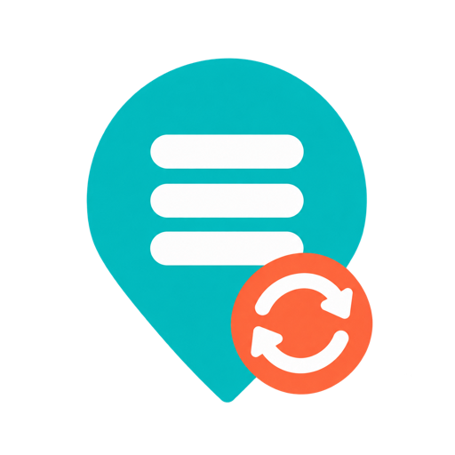

# Google Maps Lists for Home Assistant



Subscribe to shared Google Maps saved lists and turn their places into Home Assistant zones. Configure each list in the UI, then let Home Assistant refresh it automatically.

This is an experimental custom integration. It reads the undocumented list endpoint used by the Google Maps website. Google may change that format. It does not use a Google API key or access private lists.

## Install with HACS

Requires Home Assistant **2026.10.0 or newer**. Tested against 2026.10.4.

1. In HACS, open the menu and select **Custom repositories**.
2. Add `https://github.com/davidcollom/ha-google-maps-lists`, category **Integration**.
3. Download **Google Maps Lists**, then restart Home Assistant.
4. Go to **Settings → Devices & services → Add integration → Google Maps Lists**.
5. Paste the shared list URL. The list must open in a signed-out browser. Both `maps.app.goo.gl` links and full Google Maps list links are supported.
6. Choose the zone settings. Repeat **Add integration** for additional lists.

[Open this repository in HACS](https://my.home-assistant.io/redirect/hacs_repository/?owner=davidcollom&repository=ha-google-maps-lists&category=integration)

This repository can be installed as a HACS custom repository; inclusion in the default HACS catalogue is not implied.

## Settings

| Setting | Default | Behaviour |
| --- | --- | --- |
| Zone radius | 100 m | Applies to every zone imported by this list. Range: 10–5,000 m. |
| Refresh interval | 60 minutes | Range: 15–1,440 minutes. |
| Default group | Google Maps | Creates or reuses a native HA label and adds it to every zone from this list. Blank disables the default group. Use different names for different lists. |
| Default zone icon | `mdi:google-maps` | Pick an icon for the list's zones. Individual zones can override it. |
| Passive zones | Off | Passive zones can be used in automations but do not change a person's location name. |
| Remove missing places | Off | Enable to remove this list's zones when their places disappear from a successful refresh. |

Change these settings from the integration's **Configure** menu. The list URL is entered when adding the integration. To subscribe to a different list, add a separate entry.

### Names, icons and groups for individual places

Open the integration's **Configure → Customize a place**, select a place, then set a name override, choose an icon, and assign additional groups. For example, rename a street address to “Mum's house”, choose `mdi:home-heart`, and add it to a “Family” group.

Overrides use Home Assistant's entity registry, so they survive Google refreshes, integration reloads and restarts. They can also be edited through the zone entity's settings. Clearing a name or icon override restores the shared-list name or list's default icon. Entity IDs stay unchanged.

Grouping uses **native Home Assistant labels**. Every zone inherits its list's default group and can belong to multiple additional groups. Create additional labels in **Settings → Areas, labels & zones → Labels**, then select them in the place settings. Clear the list's default group if you want to manage all memberships individually. This does not create `group.*` aggregate entities.

By default, zones use the name Google publishes in the shared list. Google's [private place labels](https://support.google.com/maps/answer/6257830?hl=en-GB) belong to your signed-in account and are not available through a signed-out shared list. Use a local name override for those nicknames; list notes are not treated as place names.

Each list also creates a **saved places** diagnostic sensor and a **refresh** button. The sensor becomes unavailable when a refresh fails; the button remains available for retrying. Its `managed_zones` attribute includes retained zones when removal is disabled.

## Zone ownership and persistence

- The integration creates real `zone` entities using HA's zone implementation, with stable entity-registry IDs. They support presence detection and zone automations.
- Existing home, YAML and UI-created zones are not adopted or modified. If names overlap, HA assigns a distinct entity ID.
- A place that appears in two subscribed lists creates one zone per list. Each list owns its zones independently.
- Zones expose `source`, `source_list`, `source_list_id` (hashed list identifier), and `google_place_id` attributes. Dropped pins use coordinates as their identity.
- Renaming a Google place preserves its entity ID. Moving a dropped pin creates a new identity because it has no Google place ID.
- Failed requests, unrecognised responses and incomplete places do not trigger deletions. A validated empty list removes this entry's zones only when **Remove missing places** is enabled.
- A successful snapshot is saved in HA's local `.storage`. After a restart it restores zones even if Google is temporarily unavailable. This cache includes place names and coordinates; the config entry stores the shared list URL.
- Unloading/disabling the integration removes its active zones. Removing the integration also removes its config-entry entities and cache. Labels are left in place because other entities may use them.
- User-added labels are preserved. Changing the configured label adds the new label; old labels can be removed manually.

## Limitations

Only lists accessible without signing in are supported. The integration sends Google's `SOCS=CAI` non-essential-cookie rejection preference to avoid consent interstitials; it does not store account cookies or credentials. Keep shared list links out of public issues and logs.

Lists returning 500 or more entries are rejected because the endpoint may truncate them. Entries without a valid name and coordinates cause the refresh to fail rather than silently remove zones. No pagination support is claimed. Manual per-zone radius overrides are not supported yet.

HA's zone component does not expose normal config-entry platform forwarding. The integration isolates a dedicated `EntityPlatform` adapter in `zones.py`, reuses HA's `Zone` class and tests this against HA. Future HA changes may require adapting it.

The Google Maps format was researched using the public [gmaps-list](https://github.com/anupamchugh/gmaps-list) reader. This integration has its own asynchronous reader and uses Home Assistant's shared HTTP session.

The integration ships its own transparent icon in `brand/`, including 256 px and 512 px assets. The icon was generated with the built-in image-generation tool; the source and prompt are in [`artwork/`](artwork/).

## Development

Use Python 3.14:

```sh
uv venv --python 3.14
source .venv/bin/activate
uv pip install -r requirements-dev.txt
python -m pytest -q
ruff check .
ruff format --check .
```

Tests use synthetic locations and mock network responses. Never commit real list URLs, exports, Google responses, location caches, or account cookies. Validate a real shared list separately before relying on the integration for automations.
